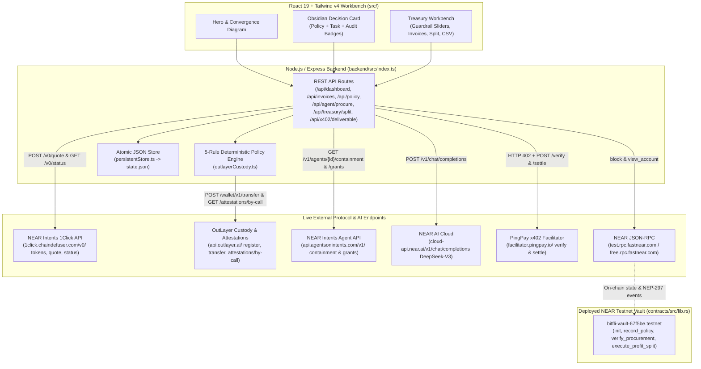

# Bitfli — Programmable Treasury & Policy-Bounded Allocation Workbench for Agent-Assisted Teams

Bitfli is a programmable treasury and policy-bounded allocation platform that lets multi-member teams accept cross-chain client inflows via **NEAR Intents (`1Click` API)**, enforce deterministic spending caps and counterparty allowlists on autonomous AI agents via **OutLayer custody**, **NEAR Intents Agent API**, and **NEAR AI Cloud**, and distribute net margin across contributors according to pre-committed split ratios.

> **Live Web Application:** [https://bitfli.xyz](https://bitfli.xyz) · **Verification & Receipts Guide:** [./docs/EVIDENCE.md](./docs/EVIDENCE.md) · **Deployed NEAR Testnet Contract:** [`bitfli-vault-67f5be.testnet`](https://testnet.nearblocks.io/address/bitfli-vault-67f5be.testnet)

---

## 1. What It Is

Teams that use AI agents to purchase cloud compute, LLM inference credits, and third-party APIs face two structural financial risks:
1. **Unbounded agent expenditure:** Giving an autonomous agent direct signing authority over an operational wallet exposes the entire treasury to prompt-injection attacks, hallucinated vendor invoices, or runaway loop spending.
2. **Fragmented cross-border inflows and manual profit accounting:** Clients pay in different tokens across Ethereum, Solana, Base, and Arbitrum, while team members and tax reserves require predictable, margin-locked distributions after operational expenses (OpEx) are deducted.

Bitfli solves both problems by separating **inbound cross-chain settlement**, **capped operational spending**, and **locked partner margin** inside a single auditable treasury pod:

```text
treasuryBalanceUsd        = GrossIntentsInflows - ApprovedOpEx - ExternalPartnerPayouts
availableOpexUsd          = treasuryBalanceUsd * (1 - profitLockPct / 100)
netDistributableProfitUsd = GrossIntentsInflows - ApprovedOpEx - TotalProfitSplits
```

### Working Example vs. Potential Applications

- **Working Example (Implemented in This Repository):** A cross-border software and design micro-agency (**Studio Meridian Pod #01**, `pod-01.bitfli.near`) that bills international clients in ETH, SOL, Base USDC, or Arbitrum USDC, locks **70%** of treasury balance for partner margin, permits autonomous agents to spend up to **$150 per transaction** and **$500 per day** across an allowlist of verified vendors (`Anthropic API`, `AWS Cloud`, `Vercel Pro`, `Figma Enterprise`, `GitHub Copilot`), and distributes net profit in a **55% / 30% / 15%** waterfall across a Lead Developer (`maya-dev.near`), a Design Partner (`sora-design.sol`), and a Tax & Ops Reserve (`ops-vault.bitfli.near`).
- **Potential Applications (Exploratory Classes):** The same policy-bounded pod model can be applied to multi-contributor creator collectives splitting sponsorship inflows, open-source maintenance guilds automating micro-bounties, or automated API merchants gating machine-to-machine deliverables via HTTP `402` (`x402`). These represent potential extensions of the architecture rather than claimed commercial deployments.

---

## 2. How It Works

Bitfli operates through a six-step, industry-neutral treasury workflow:

1. **Configure Pod Policy & Margin Lock (`POST /api/pods`, `POST /api/policy`):** Team owners define the pod identifier, maximum single-transaction cap (`maxSingleTxUsd`), rolling 24-hour spend cap (`dailySpendCapUsd`), locked profit reserve percentage (`profitLockPct`), approved vendor allowlist (`vendorAllowlist`), partner split ratios (`leadDevPct`, `designPartnerPct`, `taxReservePct`), and an emergency human kill-switch (`autonomousOpsActive`).
2. **Generate a Cross-Chain Client Invoice (`POST /api/invoices`):** When billing a client, the backend requests a live swap quote from the **NEAR Intents `1Click` API** (`POST https://1click.chaindefuser.com/v0/quote`, `swapType: "EXACT_INPUT"`) targeting canonical NEAR USDC (`nep141:17208628f84f5d6ad33f0da3bbbeb27ffcb398eac501a31bd6ad2011e36133a1`) and returns a chain-specific deposit address and QR code.
3. **Evaluate Agent Procurement Requests (`POST /api/agent/procure`):** Before any agent payment is authorized, the backend runs three coordinated checks:
   - **NEAR Intents Agent API Containment Sync (`GET https://api.agentsonintents.com/v1/agents/{agent_id}/containment` & `/grants`):** Verifies whether the agent is placed in `FROZEN` containment mode and inspects active spend grants ([./backend/src/services/agentApiService.ts](./backend/src/services/agentApiService.ts)).
   - **NEAR AI Cloud Semantic Firewall (`POST https://cloud-api.near.ai/v1/chat/completions`):** Evaluates the vendor name, amount, and task memo using `deepseek-ai/DeepSeek-V3-0324` to flag prompt-injection payloads or anomalous spend requests ([./backend/src/services/nearAiService.ts](./backend/src/services/nearAiService.ts)).
   - **Deterministic 5-Rule Policy Engine:** Verifies emergency kill-switch status, single-transaction cap, daily rolling cap, available OpEx buffer after `profitLockPct`, and case-insensitive vendor allowlist membership ([./backend/src/services/outlayerCustody.ts](./backend/src/services/outlayerCustody.ts)). If a legitimate purchase exceeds the single-transaction cap, partners can co-sign a **2-of-3 Partner Multisig Escalation** override.
4. **Execute or Record Attested Decision Receipts:** When all checks pass and a funded OutLayer custody wallet is configured, the backend submits the transfer via `POST https://api.outlayer.ai/wallet/v1/transfer` and retrieves the hardware attestation via `GET https://api.outlayer.ai/attestations/by-call/{call_id}` (`executionStatus: "LIVE_OUTLAYER_TEE"`). When running an unfunded preview or local policy check, the backend emits a deterministic SHA-256 policy commitment (`audit_sha256_...`) explicitly labeled `status: "SANDBOX_PREVIEW"` and `mode: "local_policy_check"`.
5. **Distribute Net Profit or Gate Machine Deliverables (`POST /api/treasury/split`, `GET /api/x402/deliverable`):** Owners trigger partner waterfall allocations calculated from settled inflows minus approved OpEx, issue gasless sub-contractor payment checks (`POST /api/checks`), or serve machine-payable deliverables gated by the **PingPay `x402`** protocol (`HTTP 402 Payment Required`, verified via `https://facilitator.pingpay.io/verify` and `/settle`).
6. **Export Accountant-Ready Audit CSV (`GET /api/ledger/csv`):** Every allowed inflow, approved OpEx debit, blocked rogue transfer attempt, and partner profit split is exportable as an RFC-4180 CSV containing timestamps, counterparties, routes, verdicts, and receipt hashes.

---

## 3. What You Can Verify Yourself

Every technical claim in this repository maps to a specific source file, automated test, or public on-chain receipt documented in [./docs/EVIDENCE.md](./docs/EVIDENCE.md):

| Claim | Who Enforces It | How to Verify |
| :--- | :--- | :--- |
| **On-chain pod vault contract enforces owner-only policy updates, 5-rule procurement verification, and 100% partner split math on NEAR Testnet** | NEAR Protocol runtime executing deployed Rust contract [`bitfli-vault-67f5be.testnet`](https://testnet.nearblocks.io/address/bitfli-vault-67f5be.testnet) | Inspect [`./contracts/src/lib.rs`](./contracts/src/lib.rs) and verify the 4 on-chain Testnet transactions (`init`: [`F8MAYKa8...`](https://testnet.nearblocks.io/txns/F8MAYKa8vovd2DdVz1kiSLRTCjPtM6C13MVbhnEK9RuQ), `record_policy`: [`9pqUdqaF...`](https://testnet.nearblocks.io/txns/9pqUdqaFFz6GBDfDbxTgBUWaDs59tA9Reh3n6TGao885), `verify_procurement`: [`2kJxKCQC...`](https://testnet.nearblocks.io/txns/2kJxKCQCeL1Bcmke5PMqxJAnrrVG2w2onoRC9sGLvVWM), `execute_profit_split`: [`BRtxMoRx...`](https://testnet.nearblocks.io/txns/BRtxMoRxzS7DJJW2HsGuM3oaP3P3bvGQZjFYpAKUF5vk)) in [./docs/EVIDENCE.md](./docs/EVIDENCE.md). |
| **Cross-chain invoices fetch live swap quotes and deposit addresses from the NEAR Intents `1Click` API** | Defuse / NEAR Intents `1Click` API (`https://1click.chaindefuser.com/v0/quote` & `/v0/tokens`) | Inspect [`./backend/src/services/oneClickIntents.ts`](./backend/src/services/oneClickIntents.ts) and [`./backend/src/services/oneClickService.ts`](./backend/src/services/oneClickService.ts); verify live quote `37b5ab92-657f-4f6e-9975-5fb6709de67a` (`0x6a846d70D1Eec114a096Acfa539a37Dd5d25F218`) in [./docs/EVIDENCE.md](./docs/EVIDENCE.md). |
| **OutLayer wallet registration, transfer execution, and hardware attestation lookup by `call_id` never fabricate `tee_sig_` strings** | OutLayer API (`https://api.outlayer.ai/register`, `/wallet/v1/transfer`, `/attestations/by-call/{call_id}`) + backend policy engine | Inspect [`./backend/src/services/outlayerCustody.ts`](./backend/src/services/outlayerCustody.ts) and [`./backend/src/services/outlayerService.ts`](./backend/src/services/outlayerService.ts). Unfunded checks return `status: "SANDBOX_PREVIEW"`, `mode: "local_policy_check"`, and `policyAuditHash: "audit_sha256_..."`. |
| **Agent containment and grants are queried against the NEAR Intents Agent API** | NEAR Intents Agent API (`https://api.agentsonintents.com/v1/agents/{id}/containment` & `/grants`) | Inspect `syncAgentContainmentAndGrants` in [`./backend/src/services/agentApiService.ts`](./backend/src/services/agentApiService.ts) and its integration in [`./backend/src/index.ts`](./backend/src/index.ts) and [`./src/components/DecisionEngineSection.tsx`](./src/components/DecisionEngineSection.tsx). |
| **Procurement memos are audited for prompt injection via NEAR AI Cloud (`deepseek-ai/DeepSeek-V3-0324`)** | NEAR AI Cloud (`https://cloud-api.near.ai/v1/chat/completions`) + local heuristic fallback | Inspect `auditProcurementWithNearAi` in [`./backend/src/services/nearAiService.ts`](./backend/src/services/nearAiService.ts) and test #3 in [`./backend/src/tests/bitfli.test.ts`](./backend/src/tests/bitfli.test.ts). |
| **Machine-payable deliverable endpoint enforces HTTP `402 Payment Required` and verifies `X-PAYMENT` headers via PingPay** | Express route `GET /api/x402/deliverable` + PingPay Facilitator (`https://facilitator.pingpay.io/verify` & `/settle`) | Inspect [`./backend/src/services/pingpayX402Service.ts`](./backend/src/services/pingpayX402Service.ts) and test #5 in [`./backend/src/tests/bitfli.test.ts`](./backend/src/tests/bitfli.test.ts). |
| **Zero API keys or custody secrets are committed to Git history or written to disk state** | `.gitignore` exclusions + `saveToDisk` key stripping in [`./backend/src/store/persistentStore.ts`](./backend/src/store/persistentStore.ts) | Inspect [`./backend/src/store/persistentStore.ts`](./backend/src/store/persistentStore.ts), [`./backend/data/state.example.json`](./backend/data/state.example.json), and [`./.env.example`](./.env.example). |
| **All dashboard KPIs recompute dynamically from ledger state with 10/10 automated tests passing** | Node.js test runner (`node --test`) | Run `npm test` to execute [`./backend/src/tests/bitfli.test.ts`](./backend/src/tests/bitfli.test.ts) and [`./backend/src/tests/dynamic.test.ts`](./backend/src/tests/dynamic.test.ts). |

---

## 4. Demonstrated vs. Intended Status

To keep evaluation transparent, the table below separates capabilities **demonstrated with verifiable code and receipts in this repository** from **intended production roadmap items** and **potential domain extensions**:

| Capability Area | Tier | Evidence in Repository / Controlled Tests | Required External Inputs for Full Live Execution | Remaining Implementation / Scope Boundary |
| :--- | :--- | :--- | :--- | :--- |
| **NEAR Testnet Smart Contract (`bitfli-vault-67f5be.testnet`)** | **Demonstrated** | Compiled WASM (`165 KB`), deployed on NEAR Testnet, with 4 verified transactions (`init`, `record_policy`, `verify_procurement`, `execute_profit_split`) and NEP-297 JSON events ([./docs/EVIDENCE.md](./docs/EVIDENCE.md)). | Funded NEAR Testnet signer key to submit new on-chain transactions. | **Intended:** Automated background relay signing an on-chain NEAR transaction on every HTTP `/api/policy`, `/api/agent/procure`, and `/api/treasury/split` request. |
| **NEAR Intents `1Click` Cross-Chain Quotes (`/v0/tokens`, `/v0/quote`, `/v0/status`)** | **Demonstrated** | Live `POST /v0/quote` (`dry: false`) returns real solver deposit addresses (`0x6a846d70D1Eec114a096Acfa539a37Dd5d25F218`, quote `37b5ab92-657f-4f6e-9975-5fb6709de67a`). | Optional `ONECLICK_API_KEY` for authenticated partner fee tiers (`0.0001%`); real origin-chain token deposit by client to trigger mainnet solver settlement. | **Demonstrated (Sandbox Assist):** `POST /api/invoices/:id/settle` credits the local pod ledger so evaluators can test downstream OpEx and profit-split flows without spending mainnet funds. |
| **OutLayer Custody & Attestation (`api.outlayer.ai`)** | **Demonstrated** | Live wallet provisioned via `POST /register` (`7cc3d2d8b5245fe4730af499fefd50267584f791ca5dec33360c5bdbe63fe24c`); code wired for `POST /wallet/v1/transfer` and `GET /attestations/by-call/{call_id}`. | `OUTLAYER_API_KEY` in `.env` with funded NEAR USDC balance for live on-chain transfers and hardware `call_id` generation. | Without funded transfer execution, policy checks emit `policyAuditHash` (`audit_sha256_...`) labeled `SANDBOX_PREVIEW` / `local_policy_check`. |
| **NEAR Intents Agent API (`api.agentsonintents.com/v1`)** | **Demonstrated** | `syncAgentContainmentAndGrants` queries `/v1/agents/{id}/containment` and `/grants`, blocks procurement if `FROZEN`, and renders status in the Obsidian Decision Card. | Registered `AGENT_ID` and `AGENT_API_KEY` in `.env`. | When `AGENT_API_KEY` is unset, returns `status: "SANDBOX_PREVIEW"` and `mode: "local_policy_check"`. |
| **NEAR AI Cloud Semantic Firewall (`cloud-api.near.ai/v1`)** | **Demonstrated** | `POST /api/agent/procure` calls `POST /v1/chat/completions` (`deepseek-ai/DeepSeek-V3-0324`) and surfaces verdict, rationale, and `inferenceId` in the UI. | `NEAR_AI_API_KEY` in `.env`. | When `NEAR_AI_API_KEY` is unset, runs deterministic prompt-injection and policy heuristics labeled `SANDBOX_PREVIEW` / `local_policy_check`. |
| **PingPay `x402` Machine Payment Gate (`facilitator.pingpay.io`)** | **Demonstrated** | `GET /api/x402/deliverable` returns HTTP `402 Payment Required` (`x402Version: 1`, Base USDC `0x833589fCD6eDb6E08f4c7C32D4f71b54bdA02913`) and verifies `X-PAYMENT` via `/verify` and `/settle`. | Signed `X-PAYMENT` header from a payer wallet for live facilitator settlement. | Non-`x402` procurement routes are strictly labeled `OutLayer Custody · NEAR USDC`. |
| **Creator Collectives, Open-Source Guilds & API Storefronts** | **Potential** | Configurable pod creation (`POST /api/pods`) and customizable split ratios (`POST /api/policy`) support arbitrary team structures. | Domain-specific onboarding and accounting templates. | Exploratory use cases; no commercial adoption or market-size claims are made. |

---

## 5. System Architecture

The diagram below reflects the exact implemented data paths across the React frontend ([`./src`](./src)), the Express/TypeScript backend ([`./backend/src`](./backend/src)), external NEAR services, and the deployed NEAR Testnet smart contract ([`./contracts/src/lib.rs`](./contracts/src/lib.rs)):



---

## 6. Durable Links

- **Live Production Deployment:** [https://bitfli.xyz](https://bitfli.xyz)
- **Public GitHub Repository:** [https://github.com/Jayram2204/bitfli](https://github.com/Jayram2204/bitfli)
- **Cryptographic Receipts & Reproduction Guide:** [./docs/EVIDENCE.md](./docs/EVIDENCE.md)
- **Deployed NEAR Testnet Smart Contract (`bitfli-vault-67f5be.testnet`):** [https://testnet.nearblocks.io/address/bitfli-vault-67f5be.testnet](https://testnet.nearblocks.io/address/bitfli-vault-67f5be.testnet)
- **Rust Smart Contract Source:** [./contracts/src/lib.rs](./contracts/src/lib.rs)
- **Backend Automated Verification Suites:** [./backend/src/tests/bitfli.test.ts](./backend/src/tests/bitfli.test.ts) and [./backend/src/tests/dynamic.test.ts](./backend/src/tests/dynamic.test.ts)
- **Environment Variable Template:** [./.env.example](./.env.example)
- **Secret-Free State Template:** [./backend/data/state.example.json](./backend/data/state.example.json)
- **License:** [MIT License](./LICENSE)

---

## 7. Limitations, Stated Plainly

1. **Off-Chain Application Server vs. On-Chain Contract Enforcement:** The deployed NEAR Testnet contract ([`bitfli-vault-67f5be.testnet`](https://testnet.nearblocks.io/address/bitfli-vault-67f5be.testnet)) enforces policy updates, procurement caps, and partner split validation on-chain when invoked directly (as demonstrated by the four verified Testnet transactions in [./docs/EVIDENCE.md](./docs/EVIDENCE.md)). Interactive web workbench actions (`POST /api/policy`, `POST /api/agent/procure`, `POST /api/treasury/split`) execute against the Node.js policy engine and persist to `backend/data/state.json` for sub-second responsiveness; they do not automatically broadcast a new NEAR transaction on every click unless a funded NEAR signer key is wired into the backend runtime.
2. **Hardware Attestation vs. Local Policy Audit Hash:** Genuine hardware enclave attestations from `GET https://api.outlayer.ai/attestations/by-call/{call_id}` are only produced when a funded OutLayer execution returns a `call_id`. For unfunded transfers, dry-run evaluations, or blocked rule violations, Bitfli generates a deterministic SHA-256 policy commitment (`audit_sha256_...`) and labels the output `SANDBOX_PREVIEW` / `local_policy_check` so a local rule check is never misrepresented as a hardware TEE signature.
3. **Simulated Invoice Settlement for Evaluation:** Creating an invoice (`POST /api/invoices`) requests a real cross-chain deposit address from the live NEAR Intents `1Click` API (`https://1click.chaindefuser.com/v0/quote`). Because hackathon evaluators should not need to bridge real mainnet ETH or SOL to test the workbench, clicking **Simulate Client Payment** (`POST /api/invoices/:id/settle`) records a simulated inflow in the local ledger to unlock downstream procurement and profit-split testing.
4. **External API Credential Dependencies:** Live calls to NEAR AI Cloud (`https://cloud-api.near.ai/v1/chat/completions`), the NEAR Intents Agent API (`https://api.agentsonintents.com/v1`), and OutLayer transfers (`https://api.outlayer.ai/wallet/v1/transfer`) require `NEAR_AI_API_KEY`, `AGENT_API_KEY`, and a funded `OUTLAYER_API_KEY` in `.env`. When those keys are absent, the backend degrades gracefully and explicitly tags each response with `status: "SANDBOX_PREVIEW"` and `mode: "local_policy_check"`.
